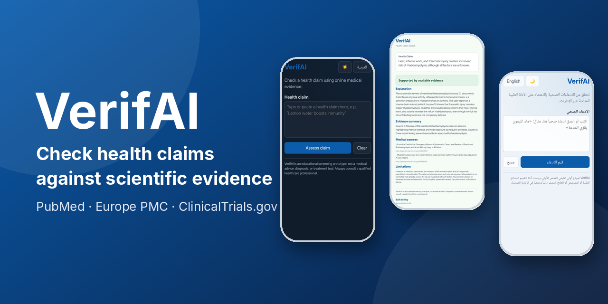
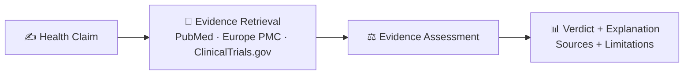
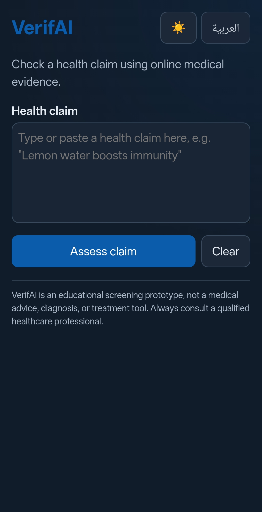
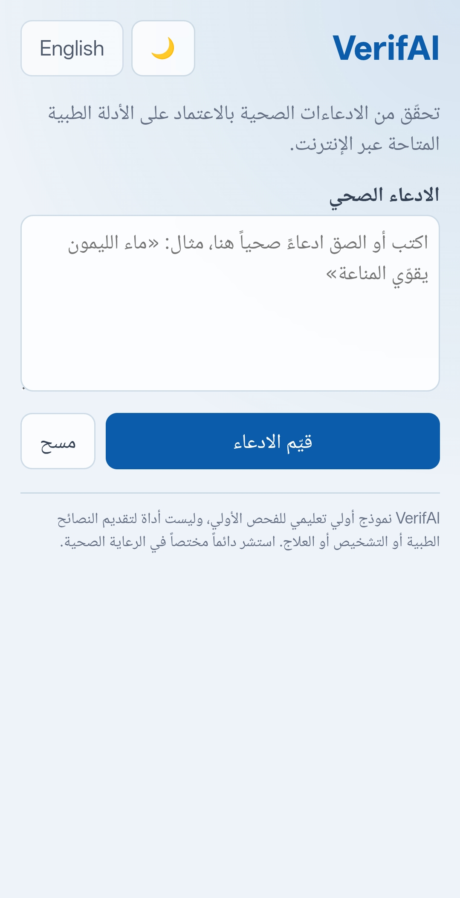
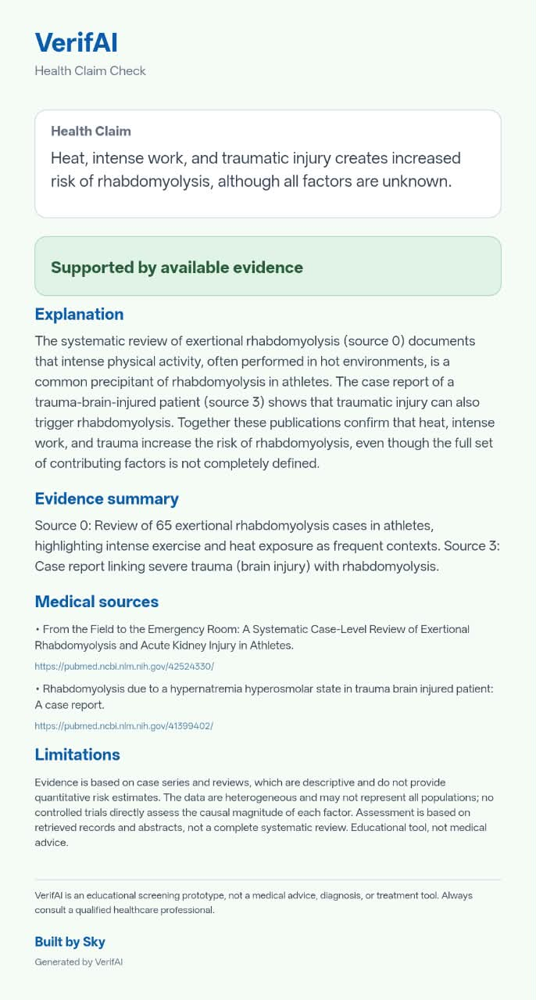
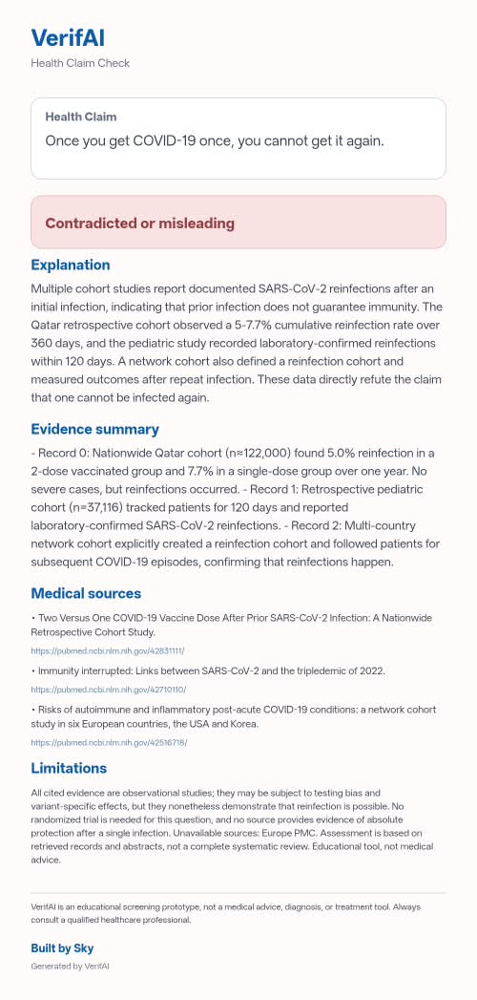

  

<h1 align="center">VerifAI</h1>

  <strong>Check health claims. Explore scientific evidence.</strong>

  An educational web app that helps people evaluate health claims against scientific evidence.

  Built as part of <strong>NYAS Junior Academy</strong>
   
  <strong>Team Lead & Developer: Asma Bouchaala</strong>

  🌐 <a href="https://verifai-9vfo.onrender.com/">Live Demo</a> ·
  📖 <a href="DEPLOY.md">Deployment Guide</a>

---

> ⚕️ **Disclaimer**
>
> VerifAI is an educational screening prototype. It does not provide medical advice, diagnosis, or treatment recommendations. Always consult a qualified healthcare professional for medical decisions.

## Why VerifAI?

Health information spreads quickly across social media. Some claims are accurate, while others are misleading or unsupported. These claims can influence people's decisions about their health.

VerifAI explores how technology can help people evaluate health claims by examining published scientific evidence rather than relying on opinions.

### Example Claims

Try evaluating claims such as:

- "Once you get COVID-19 once, you cannot get it again."
- "Regular physical activity reduces the risk of heart disease and type 2 diabetes."
- "Lemon water boosts immunity."

---

## How It Works

1. **Submit a claim:** Type or paste a health-related statement.
2. **Retrieve evidence:** The backend searches PubMed, Europe PMC, and ClinicalTrials.gov for relevant records.
3. **Assess the claim:** The system evaluates the claim against the retrieved evidence.
4. **Review the result:** Explore the verdict, explanation, evidence summary, source links, and assessment limitations.

---

## Verdict System

VerifAI uses four possible outcomes:

| Verdict | Meaning |
|---|---|
| ✅ Supported by available evidence | Retrieved evidence supports the claim. |
| ❌ Contradicted or misleading | Retrieved evidence conflicts with the claim. |
| ⚠️ Insufficient evidence | Available evidence is limited, indirect, or incomplete. |
| 🔎 Needs further review | Retrieved records do not adequately address the claim. |

**Transparency matters.** VerifAI communicates uncertainty when sources are unavailable, irrelevant, or insufficient instead of presenting unsupported conclusions.

---

## Screenshots

### English Interface — Dark Mode

### Arabic Interface — Light Mode

### Assessment — Supported

### Assessment — Contradicted

---

## Features

- Arabic and English interface.
- Right-to-left (RTL) support.
- Light and dark themes.
- Scientific evidence retrieval from multiple sources.
- Assessment verdicts with explanations.
- Direct links to retrieved scientific records.
- Explicit limitations section.
- Installable on a phone home screen through a web manifest.

---

## Scientific Data Sources

VerifAI retrieves scientific records from:

- **[PubMed](https://pubmed.ncbi.nlm.nih.gov/)** — Biomedical and life sciences literature.
- **[Europe PMC](https://europepmc.org/)** — Biomedical and life sciences research.
- **[ClinicalTrials.gov](https://clinicaltrials.gov/)** — Clinical study records.

These sources provide the evidence used during the assessment process. Their availability and relevance can affect the result.

---

## Tech Stack

| Technology | Purpose |
|---|---|
| HTML | Frontend structure |
| CSS | Interface styling |
| JavaScript | Frontend functionality |
| Node.js | Backend runtime |
| Express | API framework |
| REST API | Frontend-backend communication |
| Render | Deployment |

### API

The backend exposes an assessment endpoint:

`POST /assess`

The frontend is static and does not require a build step.

---

## Deployment

VerifAI is deployed on Render.

For hosting instructions, configuration details, and the CORS note, see:

**[DEPLOY.md](DEPLOY.md)**

> On the free hosting tier, the first request may take up to a minute while the server wakes up.

---

## Limitations

VerifAI is an educational screening tool, not a clinical decision system.

- Assessments rely on retrieved records and abstracts rather than a full systematic review.
- Results depend on which sources are available for a particular query.
- Retrieved studies may not directly answer the submitted claim.
- Scientific evidence can be incomplete or evolving.
- Results should not replace professional medical advice.

---

## Project Structure

The frontend consists of:

- `index.html`
- `style.css`
- `app.js`

### Backend

The backend is deployed separately on Render and exposes the `POST /assess` endpoint.

---

## About the Developer

**Asma Bouchaala**  
Team Lead & Developer · NYAS Junior Academy

I worked on developing VerifAI as an educational project focused on the intersection of technology, scientific evidence, and public health.

My goal was to explore how software can make scientific information more accessible and help people approach online health claims more critically.

---

*Built with curiosity, code, and a commitment to evidence.*
